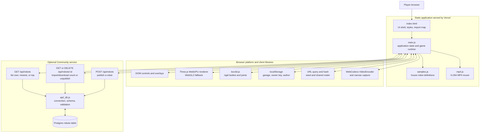
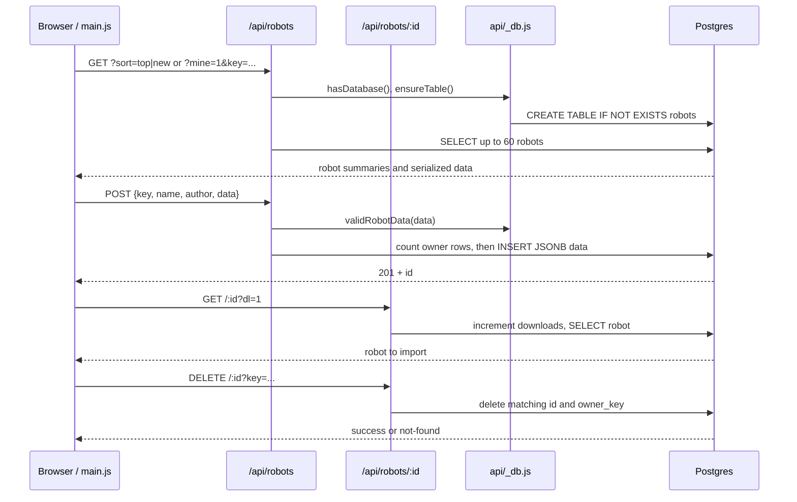

# Clanker Wars architecture

Clanker Wars is deliberately client-heavy: the browser contains the editor, renderer, physics simulation, AI, sound, persistence, share-link encoding and video export. Vercel functions are only used for the optional public robot gallery. The game remains playable without a database.

## System overview



`index.html` has no build pipeline. It supplies the page shell, CSS, and an import map that loads Three.js and Box3D from CDNs. It then loads `main.js` as an ES module. Vercel serves the static files and maps `api/robots.js` and `api/robots/[id].js` to serverless functions.

## Browser application runtime

```mermaid
flowchart LR
    Start[main.js: init] --> Init[Create WebGPU renderer<br/>and await Box3D]
    Init --> Scene[Create Three.js scene<br/>lighting, workshop floor, materials, particles]
    Scene --> Restore{Where does the roster come from?}
    Restore -->|URL hash| Shared[Decode shared serialized robots]
    Restore -->|Otherwise| Saved[Restore local garage]
    Restore -->|No saved robots| Splash[Show sample/build splash]
    Shared --> BuildStart
    Saved --> BuildStart
    Splash --> BuildStart

    subgraph BuildMode[Build mode]
        BuildStart[Palette and pointer events] --> Editor[Robot piece tree<br/>meshes, attachments, size, spin, armour]
        Editor --> Persist[Serialize and save garage]
        Persist --> Local[(localStorage)]
        Editor --> Share[Encode selected robot or roster<br/>in URL hash]
        Editor --> Community[Publish/import through API]
    end

    BuildStart -->|Battle| Enter[Select roster and seed<br/>create arena and physics world]

    subgraph BattleMode[Battle mode: render animation loop]
        Enter --> Fighter[Convert each robot into Box3D<br/>bodies, colliders, wheel/spinner joints]
        Fighter --> Tick[Fixed 1/60 s ticks]
        Tick --> AI[Seeded AI chooses drive force and steering]
        AI --> Step[Box3D world step]
        Step --> Events[Read contact-hit events]
        Events --> Damage[Damage, burning, break-offs, KO/status checks]
        Damage --> Sync[Copy physics transforms to Three.js meshes<br/>update HUD, particles, audio]
        Sync --> Render[Render post-processed scene]
        Render --> Tick
    end

    Render -->|Rematch| Enter
    Render -->|Build| BuildStart
    Render --> Record[Optional: canvas frame -> WebCodecs H.264<br/>-> mp4.js -> downloadable Blob]
```



### Startup and rendering

`init()` is the application composition root. It creates a `WebGPURenderer`, awaits both renderer and Box3D initialization, then constructs the Three.js scene, arena-floor collision mesh, lighting, materials, post-processing, UI, and event bindings. On actual WebGPU, wooden parts use Three's TSL wood material; the WebGL2 fallback uses ordinary color materials. Rendering uses a normal/depth pre-pass for GTAO followed by FXAA.

`animate()` is the sole frame loop. It clamps wall-clock deltas, runs battle logic at fixed 60 Hz when a battle exists, copies Box3D body transforms back to the visible meshes, updates the camera/HUD/particles, and runs the Three.js post-processing pipeline. Build mode still renders the editor scene but does not create a physics battle world.

### The editor’s robot model

The in-memory garage is an array of bots. A bot holds its name, AI-style index, battle-selection flag, and ordered `pieces`. A piece holds its type, parent piece, local placement, dimensions, armour, spin direction/pivot, plus the Three.js mesh used for editing and rendering. The parent relationship makes a robot a tree: removing a part removes its entire attached subtree.

The configuration tables near the top of `main.js` define every part type, armour, AI style, battle rule, and editor snap value. `TYPES` supplies geometry, mass/damage defaults and mounting rules; `ARMORS` multiplies density, hit points, damage, and flammability; `AI_STYLES` controls top speed and behavior.

### One portable robot format

`serializeBot()` converts the editor model to a compact object:

```text
{ n: name, a: aiStyleIndex, p: [pieceRow, ...] }
pieceRow = [type, parent, spin, x, y, z, normalX, normalY, normalZ,
            size..., pivotX, pivotY, pivotZ, armour]
```

The order of `p` is meaningful: parents precede children, and `parent` is an index into that same array (`-1` marks the root). `loadRobots()` is the inverse operation and includes compatibility support for legacy bare row arrays.

This one format crosses every persistence boundary:

| Source or destination | How it is used |
| --- | --- |
| `samples.js` | Bundled starter robots |
| `localStorage['rw-garage']` | Automatic local garage save/restore |
| URL hash | Base64 roster in a share link; no server required |
| Community API / `robots.data` JSONB | Published/imported robot data |

`?seed=<positive integer>` pins the match seed. The `mulberry32` random-number generator uses that value for starting locations, house-bot choice, AI variation, fire spread, particles, and other battle randomness, allowing the same roster and seed to replay consistently.

### From robot tree to fight

Entering battle gathers the bots flagged to fight. If only one is selected, the client adds a temporary opponent from `samples.js`. `buildFighter()` then translates a bot tree into Box3D objects:

1. Non-spinning attached parts are grouped into rigid assemblies.
2. A spinner and anything attached to it form a separate body with a motorized revolute joint.
3. A wheel gets a body and a free revolute joint so the chassis rolls.
4. Each visible piece gets a matching physics shape and a binding that maps its body transform back to its Three.js mesh.

Every fixed physics tick, `aiStep()` applies seeded steering and propulsion, then Box3D steps the world. Contact-hit events pass through `processHits()`; damage depends on impact speed, the source part’s damage multiplier and armour, and the mass behind the hit. Destroyed parts detach with all of their children and become bounded debris. Wood can burn and spread fire through the attachment tree. The status pass handles damage knockouts, count-outs, out-of-arena losses, and the 90-second judges’ decision.

### Other client-only capabilities

- Audio is synthesized with Web Audio in response to battle events.
- Particles and damage marks are Three.js visual effects driven by battle events, not by the server.
- Share links encode the active bot or battle roster in the URL hash.
- Recording captures rendered frames, encodes H.264 with `VideoEncoder`, and gives `createMP4()` in `mp4.js` the chunks to package into a downloadable MP4.

## Community API and database

The Community dialog is optional. The client gives each browser a random `rw-key` stored in localStorage, and optionally stores an author name. It uses that key to list or delete its own published bots; it is lightweight ownership, not login or strong authentication.



`api/_db.js` contains the shared Postgres client, lazy table creation, and payload validation. The table has an identity id, browser owner key, display metadata, `data JSONB`, a download counter, and timestamp. Every API request returns `503` when `POSTGRES_URL` is absent, and the browser presents that as “Community is offline”; the rest of the app continues to work.

## Deployment boundary

Vercel needs no build configuration for the current layout: static files are served directly and files under `api/` become serverless routes. Adding a Postgres integration that provides `POSTGRES_URL` activates Community. During local development, `vercel dev` supplies both the static site and API routes; any ordinary static server can run the game but cannot provide Community.
